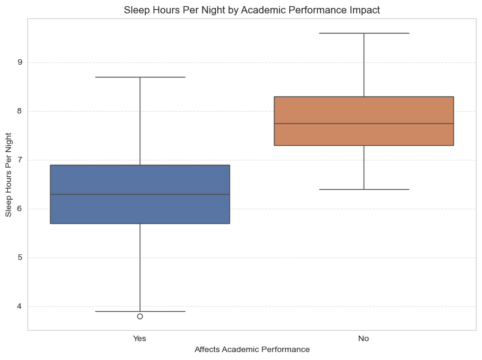
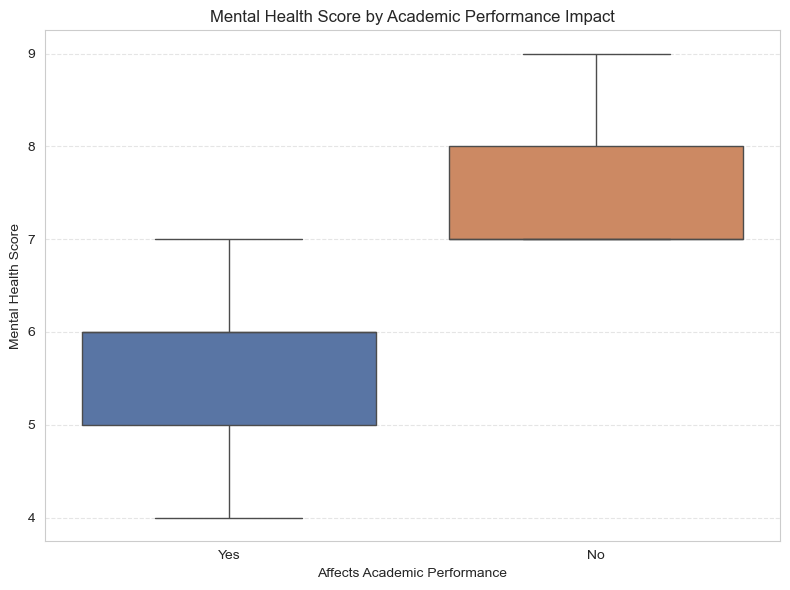
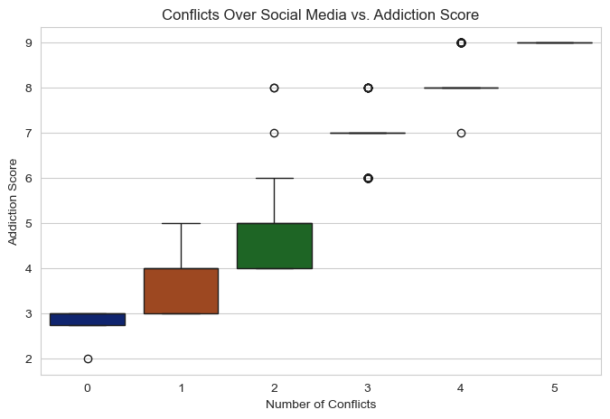
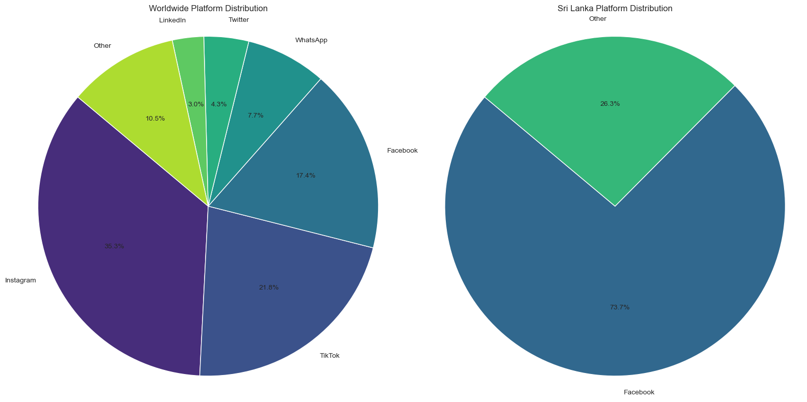
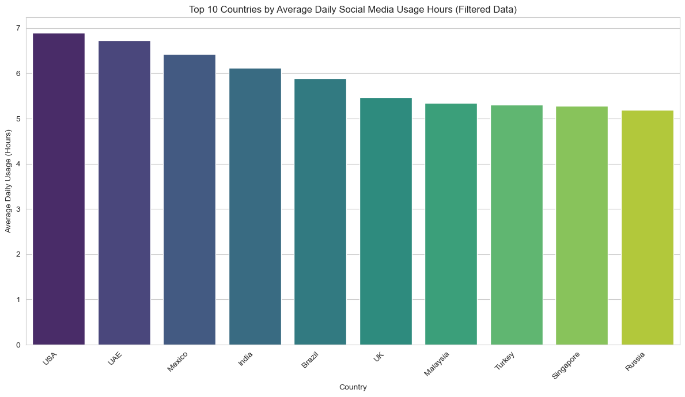
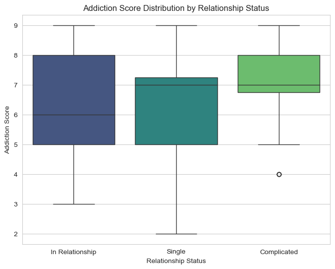

<div align="center">

# Students' Social Media Addiction: Exploratory Data Analysis

**An exploratory analysis of 705 students from 110 countries: how daily social-media use relates to sleep,
mental health, academic performance, relationships and conflicts.**

[](#quick-start)
[](requirements.txt)
[](notebooks/social_media_addiction_eda.ipynb)
[](LICENSE)

[📓 Notebook](notebooks/social_media_addiction_eda.ipynb) · [📊 Dataset](data) · [🎞️ Presentation](docs/presentation.pptx)

*Programming Starter (PRS) · M.Sc. Artificial Intelligence for Industrial Applications · OTH Amberg-Weiden · Summer Semester 2025*

</div>

---

## Key findings

| Question | Finding |
|---|---|
| Does heavy use go with less sleep? | **Yes, strongly.** Daily usage hours correlate with sleep hours at **r = −0.79** |
| Do students who say social media hurts their studies sleep less? | **7.81 h vs 6.34 h** per night (not affected vs affected) |
| …and is their mental health lower? | Mean score **7.42 vs 5.56**, about **25 % lower** |
| Does addiction rise with conflicts over social media? | Mean addiction score rises steadily, from **2.8** (0 conflicts) to **9.0** (5 conflicts) |
| Which relationship status has the highest addiction? | **"Complicated"** (mean 7.03), then Single (6.46) and In a relationship (6.34). Single students show the widest spread |
| Which platform dominates? | **Instagram** (35 %), TikTok (22 %), Facebook (17 %). In Sri Lanka, **Facebook** leads with 74 % |
| Where is daily use highest? | USA (6.9 h), UAE (6.7 h), Mexico (6.4 h), India (6.1 h); counting only countries with more than one respondent |

<p align="center">
  
  
  
</p>

## Dataset

[`data/Students Social Media Addiction.csv`](data): **705 respondents, 13 attributes, no missing or duplicate
values.** It comes from a one-time online survey of students conducted in Q1 2025 and was provided for the course.

| Group | Attributes |
|---|---|
| Demographics | `Student_ID`, `Age` (18–24), `Gender`, `Academic_Level` (high school / undergraduate / graduate), `Country` (110) |
| Usage | `Avg_Daily_Usage_Hours` (1.5–8.5, mean 4.9), `Most_Used_Platform` (12 platforms) |
| Impact | `Affects_Academic_Performance` (Yes 453 / No 252), `Sleep_Hours_Per_Night` (3.8–9.6, mean 6.9) |
| Wellbeing and relationships | `Mental_Health_Score` (4–9), `Relationship_Status`, `Conflicts_Over_Social_Media` (0–5) |
| Outcome | `Addicted_Score` (2–9, mean 6.4) |

All values are self-reported.

## Analysis

The notebook follows the three tasks of the project brief.

1. **Data preparation:** load and validate the data (structure, missing values, duplicates), profile every
   attribute and create derived categories such as age group, usage band and sleep band.
2. **Exploratory analysis:**
   - countries and respondents (top 20)
   - average daily use per country (top 10, countries with more than one respondent)
   - Sri Lanka vs Germany usage
   - usage vs sleep correlation
   - platform shares, worldwide vs Sri Lanka
3. **Question investigation:** compare sleep and mental health between students who say social media affects their
   studies and those who don't, and compare addiction scores across relationship statuses.

<p align="center">
  
</p>

<p align="center">
  
  
</p>

## Quick start

```bash
git clone https://github.com/SomanthaManuranga/Social-Media-Addition---Data-Analytics.git
cd Social-Media-Addition---Data-Analytics
pip install -r requirements.txt
```

Then open the notebook:

```bash
jupyter notebook notebooks/social_media_addiction_eda.ipynb
```

The notebook reads the CSV from `../data/`, so start it from the `notebooks/` folder (Jupyter does this by default).

## Repository structure

```
.
├── notebooks/social_media_addiction_eda.ipynb   # full analysis with outputs and written findings
├── data/Students Social Media Addiction.csv     # 705 × 13 survey dataset
├── docs/
│   ├── presentation.pptx                        # final presentation slides
│   └── figures/                                 # charts used in this README
├── requirements.txt
└── LICENSE
```

## Limitations

- **Correlation, not causation.** Self-reported survey data cannot show that social media *causes* less sleep or
  lower mental health.
- **Unequal groups.** Many countries have very few respondents (for example 19 from Sri Lanka and 14 from
  Germany), so per-country comparisons are only indicative.
- **Notes on the notebook (submitted version, kept unchanged):**
  - The usage-vs-sleep scatterplot (Task 2f) overlays a regression line for `Mental_Health_Score` instead of sleep,
    which also relabels its y-axis. The correlation printed above it (r = −0.79) is the correct usage–sleep value.
    Usage and mental health correlate similarly (r = −0.80).
  - The written findings in Task 3 mention "married" students, but the dataset only contains Single,
    In Relationship and Complicated.

## Tech stack

Python 3.12 · pandas · NumPy · Matplotlib · Seaborn · Jupyter

## License

The code and analysis are released under the [MIT License](LICENSE). The survey data was provided for the course.
